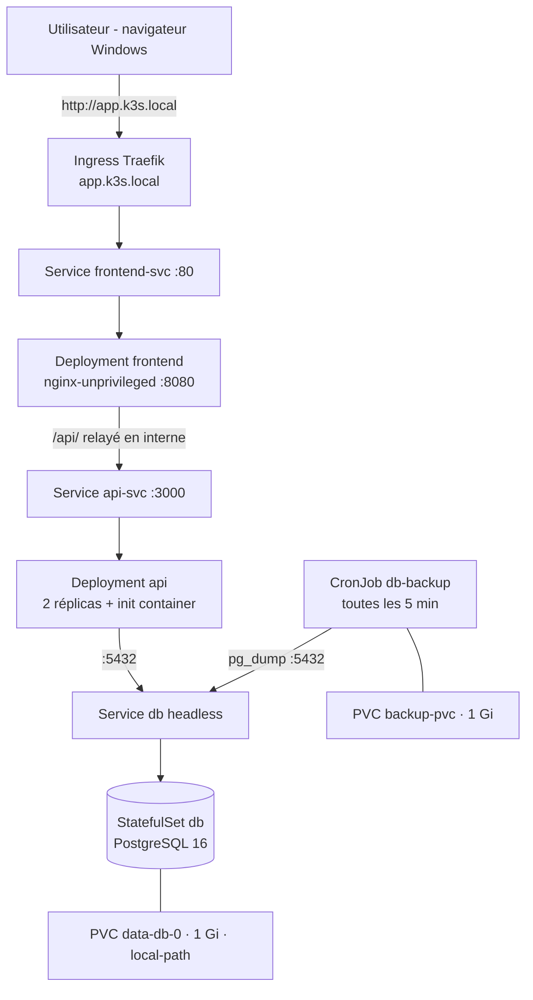

# Mini-projet 2 : TaskFlow, application trois niveaux sécurisée et persistante sur k3s

| | |
|---|---|
| **Cours** | Orchestration de conteneurs avec Kubernetes (k3s) |
| **Binôme** | Soulayma Hableni – *(nom du binôme)* |
| **Cluster** | k3s v1.36.5, 3 VMs Ubuntu 26.04 sous VMware Workstation (1 master, 2 workers) |
| **Dépôt** | https://github.com/soulaymahableni/taskflow-k8s |
| **Date** | Octobre 2026 |

## Sommaire

1. [Description de l'application](#1-description-de-lapplication)
2. [Architecture](#2-architecture)
3. [Tableau des exigences E1 à E15](#3-tableau-des-exigences-e1-à-e15)
4. [Déroulement par phase, preuves et réponses aux questions](#4-déroulement-par-phase-preuves-et-réponses-aux-questions)
5. [Matrice des flux réseau et tests de blocage](#5-matrice-des-flux-réseau-et-tests-de-blocage)
6. [Durcissement des Pods et justification des exceptions](#6-durcissement-des-pods-et-justification-des-exceptions)
7. [Difficultés rencontrées et enseignements](#7-difficultés-rencontrées-et-enseignements)
8. [Procédure de déploiement et de restauration](#8-procédure-de-déploiement-et-de-restauration)

---

## 1. Description de l'application

**TaskFlow** est un gestionnaire de tâches en trois niveaux :

| Niveau | Technologie | Image |
|---|---|---|
| Frontend | HTML/CSS/JavaScript servi par `nginxinc/nginx-unprivileged` (port 8080) | `hablani/taskflow-frontend:1.0.0` |
| API REST | Node.js 20 + Express (port 3000) | `hablani/taskflow-api:1.0.0` |
| Base de données | PostgreSQL 16 | `postgres:16-alpine` |

**Fonctionnalités :** page d'accueil, inscription et connexion (mot de passe haché avec bcrypt, session par jeton JWT), tableau de bord (statistiques, progression, filtres, recherche), **CRUD complet des tâches** (titre, description, priorité, échéance). Chaque utilisateur ne voit que ses propres tâches.

| Opération | Interface | Route API |
|---|---|---|
| Create | bouton « Nouvelle tâche » | `POST /tasks` |
| Read | liste et statistiques du dashboard | `GET /tasks`, `GET /stats` |
| Update | bouton ✏️ et case « terminée » | `PUT /tasks/:id` |
| Delete | bouton 🗑️ | `DELETE /tasks/:id` |

**Respect des contraintes du §3.1 :**
- toute la configuration est lue dans les variables d'environnement (`DB_HOST`, `DB_PORT`, `DB_NAME`, `DB_USER`, `DB_PASSWORD`, `API_PORT`, `JWT_SECRET`). L'API refuse de démarrer si l'une d'elles manque ;
- `/health` répond toujours 200 (le processus vit) et `/ready` répond 200 seulement si `SELECT 1` réussit sur la base ;
- les tables sont créées au démarrage (migration automatique `CREATE TABLE IF NOT EXISTS`) ;
- les logs sont écrits sur la sortie standard ;
- aucun secret n'est présent dans le code ni dans les images.


---

## 2. Architecture



```
Namespace taskapp : ResourceQuota + LimitRange + RBAC + NetworkPolicies + Pod Security (baseline / warn restricted)
```

**Choix d'architecture :** seul le frontend est exposé par l'Ingress. L'API n'est pas accessible de l'extérieur : nginx relaie les appels `/api/` vers `api-svc` à l'intérieur du cluster. La base n'est joignable que par l'API et par le job de sauvegarde (NetworkPolicies).

**Organisation du dépôt :**

```
app/api/            code de l'API + Dockerfile + .dockerignore
app/frontend/       pages web + Dockerfile + .dockerignore
k8s/00-namespace/   namespace, ResourceQuota, LimitRange, ServiceAccounts
k8s/10-config/      ConfigMaps (app-config, nginx-config), secret.example.yaml
k8s/20-db/          Service headless, StatefulSet, PVC + CronJob de sauvegarde, pod de restauration
k8s/30-app/         Deployment + Service API, Deployment + Service frontend, Ingress
k8s/40-security/    RBAC dev-viewer, NetworkPolicies
docker-compose.yml  test local (phase 0)
```

---

## 3. Tableau des exigences E1 à E15

| N° | Exigence | Réalisation | Preuve |
|---|---|---|---|
| E1 | Images versionnées, accessibles à tous les nœuds | Tag `1.0.0` (jamais `latest`), publiées sur Docker Hub en public | [Phase 1](#phase-1--conteneuriser-et-publier) : `docker images`, Docker Hub, Pod de test tiré sur worker1 |
| E2 | Namespace + ResourceQuota + LimitRange | Namespace `taskapp`, quota dimensionné, valeurs par défaut | [Phase 2](#phase-2--namespace-quotas-et-limites) : `describe quota/limitrange`, Pod sans resources |
| E3 | ConfigMap / Secret | `app-config`, `nginx-config`, Secret `db-credentials` (3 clés) | [Phase 3](#phase-3--configmap-et-secret) : `get configmap,secret` |
| E4 | Aucun secret dans Git | `secret.yaml` et `.env` dans `.gitignore`, `secret.example.yaml` versionné | [Phase 3](#phase-3--configmap-et-secret) : `git status` |
| E5 | StatefulSet + volumeClaimTemplates + Service headless | `db` (StatefulSet), PVC `data-db-0`, Service `db` en `ClusterIP: None` | [Phase 4](#phase-4--base-de-données-en-statefulset) |
| E6 | Persistance après suppression du Pod | Suppression de `db-0`, données conservées | [Phase 7](#phase-7--persistance-et-résilience) |
| E7 | L'API attend la base | init container `wait-for-db` (`pg_isready`) + readiness `/ready` | [Phase 5](#phase-5--api-et-frontend) : logs de l'init container |
| E8 | requests et limits sur chaque conteneur | Définis pour les 6 conteneurs + LimitRange | [Phase 2](#phase-2--namespace-quotas-et-limites) (calcul du quota) |
| E9 | Readiness `/ready` et liveness `/health` | Sondes HTTP sur l'API | [Phase 5](#phase-5--api-et-frontend) et [Phase 7](#phase-7--persistance-et-résilience) (Pod API 0/1 puis 1/1) |
| E10 | Seul le frontend exposé sur `app.k3s.local` | Ingress Traefik vers `frontend-svc` uniquement | [Phase 6](#phase-6--ingress) |
| E11 | CronJob de sauvegarde + restauration testée | `db-backup` toutes les 5 min, restauration réussie | [Phase 8](#phase-8--sauvegarde-planifiée-et-restauration) |
| E12 | ServiceAccounts sans jeton + compte de consultation | `api-sa`, `frontend-sa`, `db-sa`, `backup-sa` + `dev-viewer` | [Phase 9](#phase-9--rbac) : `auth can-i` |
| E13 | Pods non-root, sans escalade, capabilities supprimées | Tous les Pods respectent le niveau `restricted` | [Phase 10](#phase-10--durcissement-et-networkpolicies) et [§6](#6-durcissement-des-pods-et-justification-des-exceptions) |
| E14 | NetworkPolicies conformes à la matrice | deny-all + 3 autorisations | [§5](#5-matrice-des-flux-réseau-et-tests-de-blocage) |
| E15 | Dépôt Git rangé + README | Dépôt GitHub, dossiers `00` à `40`, ce README | [§8](#8-procédure-de-déploiement-et-de-restauration) |

---

## 4. Déroulement par phase, preuves et réponses aux questions

### Phase 0 : développer et tester en local

L'application a d'abord été testée avec `docker compose` (trois services : `db`, `api-svc`, `frontend`), les identifiants étant lus depuis un fichier `.env` non versionné. Le CRUD complet a été validé dans le navigateur avant le passage sur Kubernetes.

> **Question : pourquoi un secret ne doit-il jamais figurer dans le code ni dans l'image ?**
> Une image est copiée dans des registres et mise en cache sur chaque nœud ; chacune de ses couches peut être lue (`docker history`, `docker save`). Un secret inclus dedans serait lisible par toute personne ayant accès à l'image, resterait dans l'historique Git, et ne pourrait pas être changé sans reconstruire et redéployer l'image. Le secret doit être injecté au démarrage par des variables d'environnement provenant d'un Secret Kubernetes.

### Phase 1 : conteneuriser et publier

- **API** : `node:20-alpine`, `npm install --omit=dev`, utilisateur non-root (`USER 1000`), `.dockerignore` (exclut `node_modules`, `.git`, `.env`).
- **Frontend** : `nginxinc/nginx-unprivileged:1.27-alpine`, écoute sur 8080 sans droits root.
- Images construites sur la VM master (Docker Desktop ne démarrait pas sur Windows, voir §7) et publiées sur Docker Hub (option A).


**Point de contrôle :** le Pod de test a été planifié sur `k3s-worker1`, qui a bien téléchargé l'image depuis Docker Hub (pas d'`ImagePullBackOff`). Il s'arrête en `Error`, ce qui est attendu : l'API refuse de démarrer sans configuration.

```
$ kubectl get pod test -o wide
NAME   READY   STATUS   RESTARTS   AGE   IP            NODE
test   0/1     Error    0          71s   10.42.1.116   k3s-worker1
$ kubectl logs test
Variables d'environnement manquantes : DB_HOST, DB_NAME, DB_USER, DB_PASSWORD, JWT_SECRET
```


> **Question : différence entre `imagePullPolicy: Always` et `IfNotPresent` ; risque du tag `latest` ?**
> Avec `Always`, le kubelet interroge le registre à chaque démarrage de Pod et télécharge l'image si elle a changé. Avec `IfNotPresent`, il réutilise l'image déjà présente sur le nœud et ne la télécharge que si elle est absente. Le tag `latest` change de contenu à chaque publication : deux nœuds peuvent exécuter des versions différentes de la même application, on ne sait plus quelle version est déployée, et un retour arrière devient impossible. C'est pourquoi nos images sont versionnées (`1.0.0`).

### Phase 2 : namespace, quotas et limites

Le quota a été **dimensionné selon les besoins réels** de l'application :

| Composant | Pods | requests (CPU / mémoire) | limits (CPU / mémoire) |
|---|---|---|---|
| Base `db` | 1 | 100m / 256Mi | 500m / 512Mi |
| API | 2 (+1 pendant une mise à jour) | 3 × 50m / 64Mi | 3 × 300m / 256Mi |
| Frontend | 1 (+1 pendant une mise à jour) | 2 × 20m / 32Mi | 2 × 200m / 128Mi |
| Sauvegarde + restauration | 2 | 2 × 50m / 64Mi | 2 × 200m / 128Mi |
| **Total maximum** | **9** | **≈ 390m / 640Mi** | **≈ 2,2 CPU / 1,8Gi** |

D'où le quota retenu, avec une marge : `requests.cpu: 1`, `requests.memory: 1Gi`, `limits.cpu: 3`, `limits.memory: 3Gi`, `pods: 12`, `persistentvolumeclaims: 3`.


Les ServiceAccounts des composants sont créés dès cette phase, car les Pods des phases 4 et 5 y font référence (ils sont expliqués en phase 9) :


**Point de contrôle :** un Pod créé sans `resources` reçoit automatiquement les valeurs par défaut du LimitRange.


> **Question : que se passe-t-il quand un quota est dépassé au moment de créer un Pod ?**
> L'API server refuse la création du Pod (`forbidden: exceeded quota`). Pour un Pod géré par un Deployment, `kubectl apply` réussit mais le ReplicaSet n'arrive pas à créer le Pod : l'erreur n'apparaît que dans `kubectl describe rs` ou `kubectl get events`. De plus, quand un quota CPU/mémoire existe, tout conteneur doit déclarer requests et limits, sinon il est refusé. Le LimitRange évite ce problème en fournissant des valeurs par défaut.

### Phase 3 : ConfigMap et Secret

- ConfigMap `app-config` : `DB_HOST`, `DB_PORT`, `DB_NAME`, `API_PORT`.
- ConfigMap `nginx-config` : configuration nginx montée en fichier (`subPath`).
- Secret `db-credentials` : `POSTGRES_USER`, `POSTGRES_PASSWORD`, `JWT_SECRET`, généré par `kubectl --dry-run=client`. Les valeurs sensibles sont tirées au hasard par `openssl rand`, donc personne ne les a écrites à la main.


**Point de contrôle :** `git status` liste `secret.example.yaml` (fausses valeurs), mais ni `secret.yaml` ni `.env`, qui sont ignorés par `.gitignore`.


> **Question : un Secret est-il chiffré ? Que faut-il pour qu'il reste confidentiel ?**
> Non : un Secret est seulement encodé en base64, ce qui n'est pas un chiffrement (`base64 -d` suffit pour le lire), et il est stocké en clair dans etcd par défaut. Pour une vraie confidentialité, il faut activer le chiffrement au repos d'etcd (option `--secrets-encryption` de k3s), restreindre l'accès aux Secrets par RBAC (notre compte `dev-viewer` ne peut pas les lire), ne jamais les versionner en clair (ou utiliser Sealed Secrets / SOPS), et idéalement s'appuyer sur un coffre externe comme Vault.

### Phase 4 : base de données en StatefulSet

- Service headless `db` (`clusterIP: None`), puis StatefulSet `db` avec `volumeClaimTemplates` (1 Gi, `local-path`).
- `PGDATA=/var/lib/postgresql/data/pgdata` : sous-dossier du volume, car PostgreSQL refuse de s'initialiser dans un dossier non vide (`lost+found`).
- Readiness et liveness par `pg_isready`. Utilisateur non-root `postgres` (uid 70).


> **Question : pourquoi un StatefulSet plutôt qu'un Deployment pour une base de données ?**
> Le StatefulSet donne à chaque Pod une identité stable (nom `db-0`, DNS `db-0.db`) et, grâce à `volumeClaimTemplates`, un volume persistant propre (`data-db-0`) qui est toujours rattaché au même Pod, même après sa suppression. Les Pods sont créés et arrêtés dans l'ordre. Un Deployment crée des Pods interchangeables aux noms aléatoires, qui partageraient le même PVC et risqueraient de corrompre les données : il convient aux composants sans état (API, frontend).

### Phase 5 : API et frontend

- **API** : Deployment de 2 réplicas. `envFrom` sur le ConfigMap et `secretKeyRef` pour `DB_USER`, `DB_PASSWORD` et `JWT_SECRET`. Init container `wait-for-db` qui boucle sur `pg_isready -h db`. Readiness sur `/ready`, liveness sur `/health`, requests/limits.
- **Frontend** : nginx configuré par le ConfigMap `nginx-config` (`proxy_pass http://api-svc:3000/`).


On observe le cycle de démarrage : `PodInitializing` (l'init container attend la base), puis `0/1 Running` (la readiness n'est pas encore validée), puis `1/1 Running`.


Le test vers `localhost` a échoué parce que `localhost` est résolu en IPv6 (`::1`) dans le conteneur, alors que nginx n'écoute qu'en IPv4. Avec `127.0.0.1`, le relais `/api/` fonctionne :


> **Question : que fait Kubernetes de l'API tant que la readiness probe échoue ?**
> Le Pod reste `Running` mais non prêt (`0/1`) : il est retiré des Endpoints du Service `api-svc` et ne reçoit aucun trafic. Il n'est pas redémarré, ce qui est le rôle de la liveness. Dès que `/ready` répond 200, il est réintégré au Service. Lors d'un rolling update, Kubernetes attend que les nouveaux Pods soient prêts avant de supprimer les anciens. Ce comportement est visible en phase 7.

### Phase 6 : Ingress

Ingress `taskflow` (classe `traefik`) sur `app.k3s.local` vers `frontend-svc:80`. Entrée ajoutée dans le fichier hosts de Windows : `192.168.190.153  app.k3s.local`.


**Point de contrôle :** les données saisies dans le navigateur (compte et 3 tâches) sont bien enregistrées dans PostgreSQL.


> **Question : pourquoi ne pas exposer aussi l'API et la base par l'Ingress ?**
> Pour réduire la surface d'attaque. La base n'a aucune raison d'être joignable de l'extérieur, et l'API n'est appelée que par le frontend, qui relaie `/api/` à l'intérieur du cluster. Un point d'entrée unique est plus simple à protéger (TLS, limitation de débit) et évite les problèmes de CORS, puisque le navigateur reste sur la même origine.

### Phase 7 : persistance et résilience

**Avant :** `db-0` tourne sur `k3s-worker1`, PVC `data-db-0`, 3 tâches.


**Suppression de `db-0` :** le Pod est recréé avec **le même nom** (AGE 10s). Pendant l'indisponibilité de la base, le Pod API `jwgld` passe à `0/1`, car sa readiness `/ready` échoue et il est retiré du Service. Il revient ensuite à `1/1` **sans redémarrage** (RESTARTS = 0) : c'est l'illustration directe de la question de la phase 5.


**Après :** le PVC `data-db-0` est le même et les 3 tâches sont toujours présentes, y compris dans le navigateur, sans reconnexion.

> 📸 *Capture à ajouter : `SELECT count(*) FROM tasks;` après la recréation de db-0 (résultat : 3).*

**Résilience de l'API :** une boucle `curl` vers `/api/health` via l'Ingress continue de recevoir des réponses `200` pendant la suppression d'un des deux Pods API : l'autre réplica prend le relais, et le Deployment recrée le Pod supprimé.

> 📸 *Capture à ajouter : la suite de `200` pendant la suppression d'un Pod API.*

> **Question : où se trouvent physiquement les données avec local-path ; que se passe-t-il si le nœud tombe ?**
> Dans un dossier du disque d'un seul nœud (ici `k3s-worker1`, sous `/var/lib/rancher/k3s/storage/pvc-…`). Le PersistentVolume porte une `nodeAffinity` : `db-0` est toujours replanifié sur ce nœud, ce qui explique la persistance observée. Si ce nœud tombe, `db-0` reste `Pending` et l'application est indisponible ; si son disque est perdu, les données le sont aussi. Il faudrait un stockage répliqué (Longhorn, Ceph, NFS) ou une réplication PostgreSQL.

### Phase 8 : sauvegarde planifiée et restauration

- PVC `backup-pvc` (1 Gi) et CronJob `db-backup` toutes les 5 minutes (`concurrencyPolicy: Forbid`), qui lance `pg_dump -h db` vers `/backup/dump-AAAAMMJJ-HHMM.sql`.
- Le mot de passe est passé à `pg_dump` par la variable `PGPASSWORD`, alimentée par le Secret.
- Bonus (§11) : conservation limitée aux 10 dumps les plus récents.


**Test de restauration :** un Pod outil `restore` (label `tier: backup`, durci) monte `backup-pvc`. Après la suppression d'une tâche, les tables ont été vidées puis le dump rechargé avec `psql -f`.


> **Question : une sauvegarde stockée sur le même nœud que la base protège-t-elle d'une panne de ce nœud ?**
> Non. `backup-pvc` est aussi en `local-path`, donc sur le disque d'un seul nœud, potentiellement le même que la base. Elle protège d'une erreur logique (suppression accidentelle, comme dans notre test), mais pas de la perte du nœud. Il faudrait externaliser les dumps hors du nœud et du cluster (stockage objet S3/MinIO, NFS distant, Velero) et appliquer la règle 3-2-1.

### Phase 9 : RBAC

- **ServiceAccounts applicatifs** `api-sa`, `frontend-sa`, `db-sa`, `backup-sa` avec `automountServiceAccountToken: false`.
- **Compte de consultation** `dev-viewer` : Role `pod-viewer` (`get`, `list`, `watch` sur `pods`, `pods/log`, `services`), limité au namespace `taskapp` par un RoleBinding.


```
$ kubectl -n taskapp get pods --as=system:serviceaccount:taskapp:dev-viewer
NAME                        READY   STATUS    RESTARTS   AGE
api-664544895d-dc66k        1/1     Running   0          16m
...
$ kubectl -n taskapp get secrets --as=system:serviceaccount:taskapp:dev-viewer
Error from server (Forbidden): secrets is forbidden: User "system:serviceaccount:taskapp:dev-viewer"
cannot list resource "secrets" in API group "" in the namespace "taskapp"
```

> 📸 *Capture à ajouter : `kubectl -n taskapp exec deploy/api -- ls /var/run/secrets/kubernetes.io/serviceaccount` (doit échouer : aucun jeton monté).*

> **Question : pourquoi désactiver le montage automatique du jeton ?**
> Nos applications n'appellent jamais l'API Kubernetes. Un jeton monté ne leur sert à rien, mais un attaquant qui exploiterait une faille de l'application pourrait le lire et agir sur le cluster avec les droits du ServiceAccount. Le désactiver supprime ce vecteur d'attaque : c'est le principe du moindre privilège.

### Phase 10 : durcissement et NetworkPolicies

Voir le [§6](#6-durcissement-des-pods-et-justification-des-exceptions) pour le durcissement et le [§5](#5-matrice-des-flux-réseau-et-tests-de-blocage) pour le réseau.

> **Question : pourquoi poser d'abord un « deny all » ?**
> Par défaut, tous les Pods peuvent communiquer entre eux. En interdisant tout puis en n'autorisant que les flux nécessaires (liste blanche), un flux oublié est bloqué plutôt qu'ouvert par erreur, et tout nouveau Pod est protégé d'office.
>
> **Question : quelle est la limite d'une politique qui ne filtre que le trafic entrant ?**
> Le trafic sortant reste libre : un Pod compromis peut exfiltrer des données vers Internet ou joindre des namespaces non protégés. Il faudrait ajouter des politiques `Egress`, en autorisant explicitement le DNS (port 53 vers kube-dns). De plus, le filtrage repose sur des labels : quiconque peut créer un Pod avec `tier: api` obtiendrait l'accès à la base, d'où l'importance du RBAC sur la création de Pods.

---

## 5. Matrice des flux réseau et tests de blocage

| Source | Destination | Port | Autorisé | Politique |
|---|---|---|---|---|
| Traefik (kube-system) | frontend | 8080 | ✅ Oui | `allow-traefik-to-frontend` |
| frontend | api | 3000 | ✅ Oui | `allow-frontend-to-api` |
| api | db | 5432 | ✅ Oui | `allow-api-to-db` |
| job de sauvegarde | db | 5432 | ✅ Oui | `allow-api-to-db` (label `tier: backup`) |
| frontend | db | 5432 | ❌ Non | `default-deny-ingress` |
| tout autre Pod | api, db | – | ❌ Non | `default-deny-ingress` |


**Tests :**

| # | Test | Attendu | Résultat |
|---|---|---|---|
| 1 | Pod sans label → `db:5432` | bloqué | ✅ `terminated (Error)` : `pg_isready` sans réponse |
| 2 | Pod `tier=frontend` → `db:5432` | bloqué | ✅ `db:5432 - no response` |
| 3 | Pod sans label → `api-svc:3000` | bloqué | ✅ délai dépassé |
| 4 | Pod API → `db:5432` | autorisé | ✅ connexion OK |
| 5 | Job de sauvegarde → `db:5432` | autorisé | ✅ `Sauvegarde OK` |
| 6 | Navigateur → `app.k3s.local` | autorisé | ✅ application fonctionnelle |

```
$ kubectl -n taskapp run np-front --rm -it --restart=Never --labels=tier=frontend --image=postgres:16-alpine -- pg_isready -h db -t 5
db:5432 - no response
pod taskapp/np-front terminated (Error)

$ kubectl -n taskapp logs job/test-backup-np
Sauvegarde OK : /backup/dump-20261025-1221.sql (4613 octets)
```

> 📸 *Captures à ajouter : tests 1, 3 et 4.*

---

## 6. Durcissement des Pods et justification des exceptions

| Réglage | API | Frontend | Base | Sauvegarde |
|---|---|---|---|---|
| `runAsNonRoot: true` | ✅ uid 1000 | ✅ uid 101 | ✅ uid 70 | ✅ uid 70 |
| `allowPrivilegeEscalation: false` | ✅ | ✅ | ✅ | ✅ |
| `capabilities.drop: ["ALL"]` | ✅ | ✅ | ✅ | ✅ |
| `seccompProfile: RuntimeDefault` | ✅ | ✅ | ✅ | ✅ |
| `readOnlyRootFilesystem: true` | ✅ (+ emptyDir `/tmp`) | ✅ (+ emptyDir `/tmp`) | ❌ exception | ✅ |
| Jeton de ServiceAccount monté | non | non | non | non |

Vérification dans les conteneurs :

```
--- utilisateur API :      uid=1000(node) gid=1000(node) groups=1000(node)
--- utilisateur frontend : uid=101(nginx) gid=101(nginx) groups=101(nginx)
--- utilisateur base :     uid=70(postgres) gid=70(postgres) groups=70(postgres)
--- écriture dans l'API :  touch: /test-ecriture: Read-only file system
```

**Pod Security Admission :** le namespace a été passé en `enforce=restricted`. **Tous les Pods de l'application ont redémarré sans erreur**, y compris les sauvegardes, alors qu'un Pod non durci est refusé :


| Règle de `restricted` violée par un Pod par défaut | Réglage exigé |
|---|---|
| escalade de privilèges autorisée | `allowPrivilegeEscalation: false` |
| capabilities non supprimées | `capabilities.drop: ["ALL"]` |
| exécution possible en root | `runAsNonRoot: true` |
| pas de profil seccomp | `seccompProfile.type: RuntimeDefault` |

Configuration finale du namespace : `enforce=baseline` et `warn=restricted`, pour pouvoir lancer des Pods de diagnostic (tests réseau), qui reçoivent seulement un avertissement.

**Exception justifiée : base de données, `readOnlyRootFilesystem: false`.** PostgreSQL écrit en dehors de son volume : socket et fichier de verrou dans `/var/run/postgresql`, fichiers temporaires dans `/tmp`. Un système de fichiers en lecture seule empêche son démarrage. Toutes les autres protections sont appliquées (uid 70, pas d'escalade, capabilities supprimées, seccomp), et `fsGroup: 70` permet l'écriture sur le volume persistant. *Amélioration possible : monter des `emptyDir` sur ces deux dossiers pour passer en lecture seule.*

---

## 7. Difficultés rencontrées et enseignements

| Difficulté | Cause | Solution |
|---|---|---|
| Docker Desktop ne démarrait pas sur Windows | « Virtualization support not detected » ; activer la virtualisation Windows risquait de perturber VMware | Images construites directement sur la VM master (option prévue au §6 de l'énoncé) |
| Windows ne joignait pas les VMs (`Connection timed out`) | Windows n'a pas de carte sur le réseau `192.168.56.x` des VMs | Utilisation de l'adresse NAT de la master, `192.168.190.153` (carte VMnet8) |
| Installation de Docker impossible sur la VM | Miroir `tn.archive.ubuntu.com` refusant les connexions, IPv6 injoignable | apt forcé en IPv4 et passage sur le miroir `mirrors.edge.kernel.org` en HTTPS |
| `docker login` refusé | Collage impossible dans le champ mot de passe | Jeton d'accès passé par `--password-stdin` |
| Test `localhost:8080` refusé dans le frontend | `localhost` résolu en IPv6 alors que nginx écoute en IPv4 | Test avec `127.0.0.1` |
| Restauration : fichier introuvable | Nom de dump d'exemple non remplacé ; heure des dumps en UTC | Choix du bon dump après vérification de son contenu (`grep COPY`) |

**Enseignements :**
- Les **sondes** ne sont pas décoratives : on a vu un Pod API retiré du Service pendant la panne de la base, puis réintégré automatiquement sans redémarrage.
- Un **Secret n'est qu'encodé** : il faut le protéger par le RBAC, ne pas le versionner, et ne pas l'afficher dans un compte rendu.
- Le **deny-all réseau** puis les autorisations explicites rendent les flux lisibles et vérifiables.
- `local-path` assure la persistance face à la perte d'un **Pod**, pas d'un **nœud** : la sauvegarde doit sortir du nœud.
- Une application **conçue pour Kubernetes** (configuration par variables d'environnement, `/health`, `/ready`, logs sur stdout, utilisateur non-root) se déploie et se durcit sans effort, jusqu'au niveau `restricted`.

---

## 8. Procédure de déploiement et de restauration

### Prérequis
- Cluster k3s avec Traefik et la StorageClass `local-path`, `kubectl` configuré.
- Fichier hosts de Windows : `192.168.190.153   app.k3s.local`

### Construire et publier les images
```bash
docker build -t hablani/taskflow-api:1.0.0 app/api
docker build -t hablani/taskflow-frontend:1.0.0 app/frontend
docker push hablani/taskflow-api:1.0.0
docker push hablani/taskflow-frontend:1.0.0
```

### Créer le Secret (jamais versionné)
```bash
kubectl create secret generic db-credentials -n taskapp \
  --from-literal=POSTGRES_USER=taskuser \
  --from-literal=POSTGRES_PASSWORD="$(openssl rand -base64 18)" \
  --from-literal=JWT_SECRET="$(openssl rand -hex 32)" \
  --dry-run=client -o yaml > k8s/10-config/secret.yaml
```

### Ordre de déploiement
```bash
kubectl apply -f k8s/00-namespace/
kubectl label ns taskapp pod-security.kubernetes.io/enforce=baseline pod-security.kubernetes.io/warn=restricted --overwrite
kubectl apply -f k8s/10-config/configmap.yaml -f k8s/10-config/secret.yaml
kubectl apply -f k8s/20-db/01-service-headless.yaml -f k8s/20-db/02-statefulset.yaml -f k8s/20-db/03-backup.yaml
kubectl -n taskapp rollout status statefulset/db
kubectl apply -f k8s/30-app/
kubectl -n taskapp rollout status deployment/api
kubectl apply -f k8s/40-security/
```
Ne pas appliquer `secret.example.yaml` (fausses valeurs).

### Sauvegarde immédiate
```bash
kubectl -n taskapp create job --from=cronjob/db-backup backup-manuel
kubectl -n taskapp logs job/backup-manuel
```

### Restauration
```bash
kubectl apply -f k8s/20-db/04-restore-pod.yaml
kubectl -n taskapp wait --for=condition=Ready pod/restore
kubectl -n taskapp exec restore -- ls -lh /backup
# remplacer dump-AAAAMMJJ-HHMM.sql par le fichier choisi (heure en UTC)
kubectl -n taskapp exec restore -- sh -c 'psql -h db -U "$POSTGRES_USER" -d "$POSTGRES_DB" -c "DROP TABLE IF EXISTS tasks, users CASCADE;"'
kubectl -n taskapp exec restore -- sh -c 'psql -h db -U "$POSTGRES_USER" -d "$POSTGRES_DB" -f /backup/dump-AAAAMMJJ-HHMM.sql'
kubectl -n taskapp delete pod restore
```

### Vérifications de sécurité
```bash
SA=system:serviceaccount:taskapp:dev-viewer
kubectl auth can-i list pods   -n taskapp --as=$SA   # yes
kubectl auth can-i delete pods -n taskapp --as=$SA   # no
kubectl auth can-i get secrets -n taskapp --as=$SA   # no
kubectl -n taskapp run np-test --restart=Never --image=postgres:16-alpine -- pg_isready -h db -t 5
kubectl -n taskapp logs np-test   # db:5432 - no response
kubectl -n taskapp delete pod np-test
```
